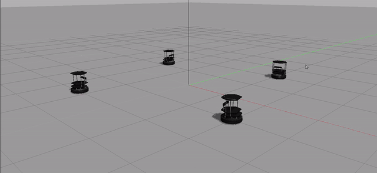
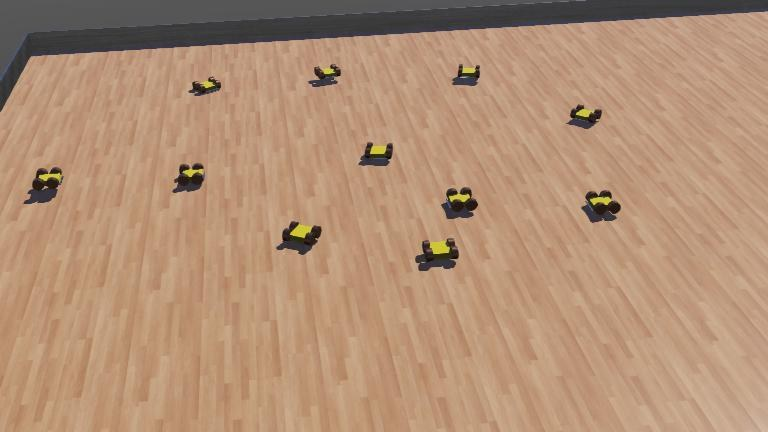
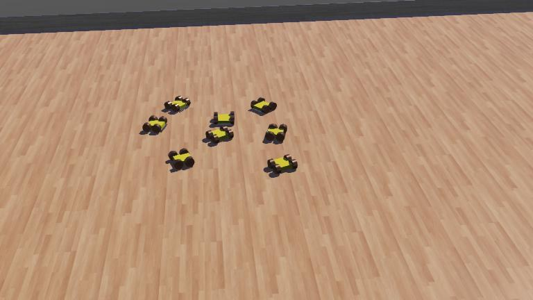
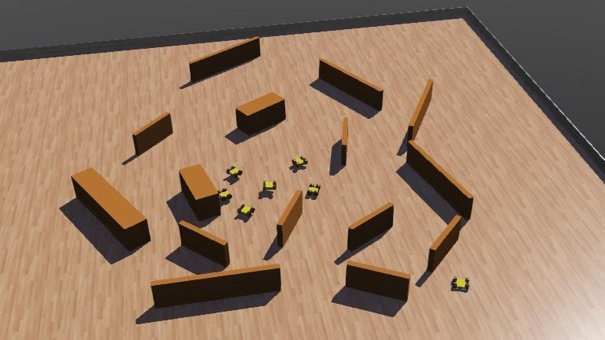
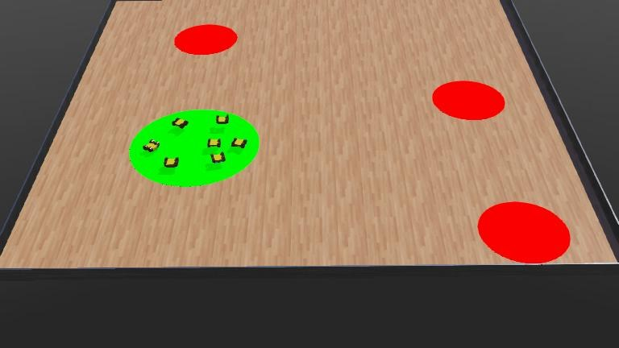
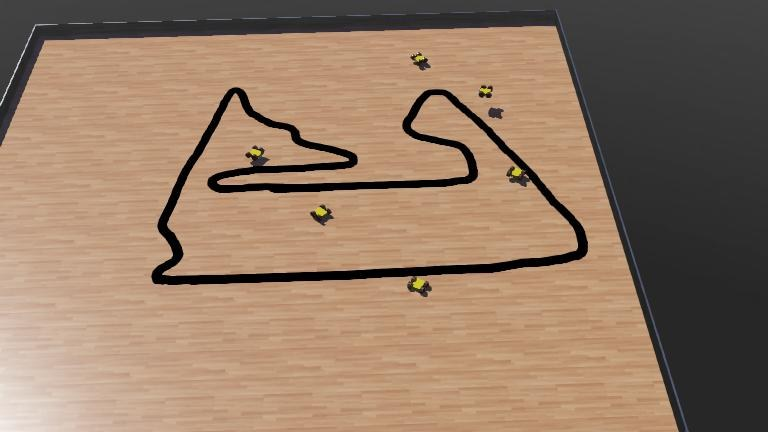

# Multi-robot coursework: ROS 1 TurtleBots and a Webots Zumo swarm

Two individual practicals from the course "Sistemas Multirrobot", Universidad de Alicante, 2022-23. **Individual project.**

- `ros1/`: controlling several Kobuki TurtleBots with ROS 1 in Gazebo (practicals 1-3), plus bumper scripts for one real TurtleBot.
- `webots/`: swarm behaviours in C++ for a Pololu Zumo model in Webots (practical 4).

## Demo



No video is included. The images below are the Webots world previews of the swarm behaviours (aggregation, dispersion, obstacle avoidance, foraging, line following); they are stills, not recordings of the robots moving.







## ROS 1 (`ros1/`)

Written for the course as individual practicals.

- **P1 (`p1-sm1`)**, package `sm1`: launch files that spawn four TurtleBots (`Robot1`..`Robot4`) in Gazebo at fixed poses. `scripts/ej1.py` publishes the same `Twist` (0.4 m/s linear, 0.7 rad/s angular) to the four `/robotN/mobile_base/commands/velocity` topics. `scripts/ej2.py` moves one robot at a time, switching with a timer.
- **P2 simulation (`p2-sm1`)**, package `sm1`: bumper-driven behaviour with `kobuki_msgs/BumperEvent`. `p2_bumper_2.py` takes the robot namespace as an argument. Extra launch files and Gazebo worlds (`barrier`, `sala`, `walls`, `empty`).
- **P2 real robot (`p2-real`)**, package `turtlebots`: bumper scripts for a physical TurtleBot in the `/tb4` namespace (drive forward at 0.2 m/s, reverse and turn after a bumper hit). Not tested here.
- **P3 (`p3-sm3`)**, package `sm3`: `3_robots.launch` spawns three robots, static transforms tie their odometry frames to a `world` frame, and `rviz/robots_config.rviz` shows them in RViz. `scripts/p2_bumper_2.py` is a copy of the P2 script so that `bumper.launch` works inside this package.

`p1-sm1` and `p2-sm1` both declare the package name `sm1`; put only one of them in a catkin workspace at a time.

Run (ROS distribution not recorded in the files; the Kobuki / TurtleBot simulation packages are required):

```
# copy one package folder into <catkin_ws>/src, then
catkin_make && source devel/setup.bash
roslaunch sm1 main.launch          # P1 / P2; for P3: roslaunch sm3 main.launch
rosrun sm1 ej1.py                  # P1
rosrun sm1 p2_bumper_2.py robot1   # P2
```

The Gazebo worlds are saved scenes that use stock Gazebo models (for example `jersey_barrier`). I have not run these launch files while preparing this repository.

## Webots (`webots/`)

- `protos/Zumo_Robot.proto`: a Zumo robot model with distance and floor infrared sensors and differential drive.
- Six C++ controllers, one per behaviour: `Agregacion` (aggregation), `Dispersion`, `Evita_Obstaculos` (obstacle avoidance), `Flocking`, `Foraging`, `SeguiLineas` (line following). Each has a Makefile.
- One world per behaviour in `worlds/*.wbt`, with several robots running the controller. The first robot of each world uses the matching controller; the PROTO default controller is `void`.
- `protos/Obstacle.proto`, `protos/icons/Obstacle.png`, `protos/tinker.obj`: obstacle PROTO and a mesh used by the line-following world (Tinkercad export).

Run: open a world in Webots (File > Open World), compile the controller from the Webots editor or with `make` inside the controller folder with `WEBOTS_HOME` set. The worlds load stock assets from `raw.githubusercontent.com/cyberbotics/webots/R2023a/...`, so they need internet access.

## Results

Source code only. No measurements or recordings are stored here; the previews above show the arenas, not the outcome of the behaviours.

## Stack

ROS 1 (catkin, rospy), Gazebo, RViz, Kobuki / TurtleBot packages, Python; Webots R2023a, C++.

## Licence

MIT for my own code, see `LICENSE`. Exceptions:

- `webots/protos/Obstacle.proto` and its icon follow a Cyberbotics asset: "Copyright Cyberbotics Ltd. Licensed for use only with Webots" under the [Webots Assets License](https://cyberbotics.com/doc/guide/webots-assets-license). They are not covered by the MIT licence. The header is kept.
- The `Makefile` in each Webots controller folder is the standard Cyberbotics template, licensed under Apache 2.0. They are not covered by the MIT licence.
- Assets loaded at runtime from the Webots repository, the Gazebo stock models and the TurtleBot / Kobuki packages keep their own licences.
- `webots/protos/tinker.obj` is a Tinkercad export; I have not confirmed its licence terms.

Code comments are in Spanish.
